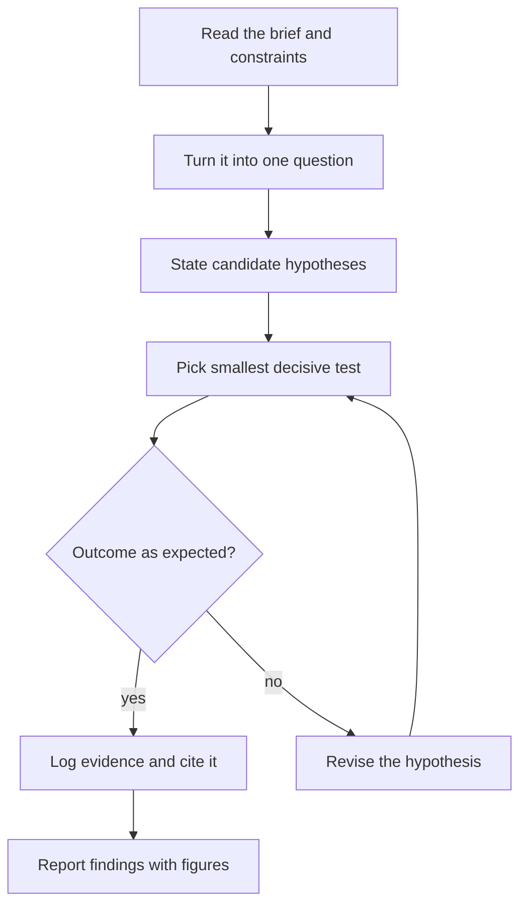
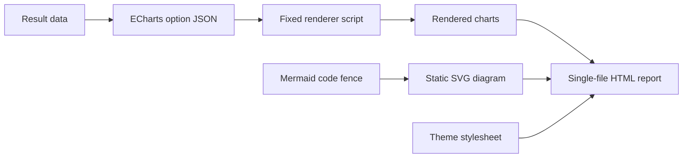
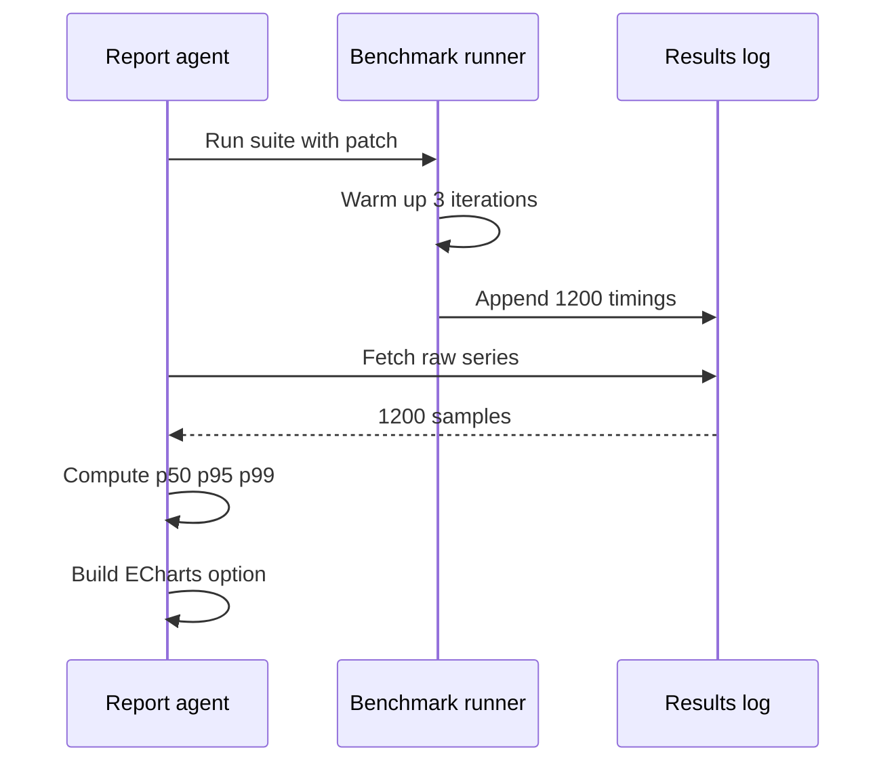
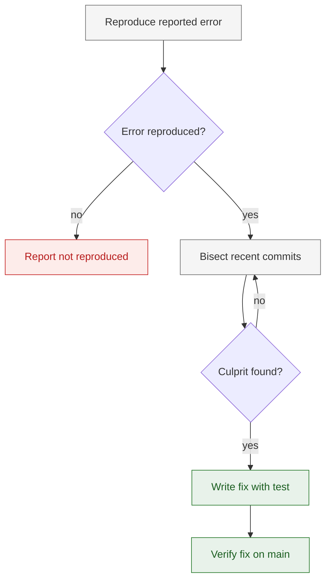

# Figures and tables — chart, diagram, and table standards

Turn findings into visual evidence: pick the right form, build it as pure JSON (ECharts) or fenced code (Mermaid), package it with its source, and gate it before shipping. This file owns chart-type selection, color, ECharts options, Mermaid syntax, the figure package, table rules, anti-patterns, and accessibility. Report structure and prose style live in sibling references.

Scope: HTML reports render ECharts for data charts and Mermaid for diagrams. Markdown reports support Mermaid code fences only — quantitative findings become tables, never charts.

## Contents

1. Chart-type decision table
2. When NOT to visualize
3. The 10 figure quality gates
4. Color
5. ECharts option snippets (JSON)
6. Mermaid snippets
7. Figure package contract
8. Table design rules
9. Anti-patterns
10. Accessibility

## 1. Chart-type decision table

Match the data shape and the question; the first matching row wins.

| Data shape / question | Use | Avoid |
|---|---|---|
| Compare values across ≤7 categories | Vertical bar, value labels on top | Pie; 3D bars |
| Rank many items (>7) | Horizontal bar sorted by value | Unsorted bars; pie |
| Trend over time | Line, 1–4 series, one point per interval | Pie for time; 5+ lines on one axis (split it) |
| Distribution, n ≲ 20 per group | Strip/scatter showing every point; lines joining paired observations | Bar with error bars (hides the distribution) |
| Distribution, larger n | Boxplot or histogram | Bar of means alone |
| Relationship between two variables | Scatter (+ color per group) | Dual y-axes |
| Composition / parts of a whole | Stacked bar (absolute) or 100% stacked (share) | Pie with >5 slices; pie with similar parts |
| Pie corner case | Pie only for ≤5 parts with one dominant, only to show dominance, not to compare parts | Donut rings; exploded slices |
| Magnitude of one measure per item | Bar from a 0 baseline | Truncated baseline |
| Geographic pattern | Choropleth, only when location itself is the finding | Map as decoration |
| Process / workflow / architecture | Mermaid `flowchart TD` (process) or `flowchart LR` (components) | Prose steps; ASCII art |
| Timeline / interaction sequence | Mermaid sequence diagram; gantt for schedules | Bar chart of steps |
| Decision logic | Mermaid flowchart with `{}` decision nodes | Nested if-bullets |
| Causal chain | Mermaid flowchart, one edge per causal claim | Causal chains in prose |

## 2. When NOT to visualize

| Situation | Do instead |
|---|---|
| < 3 data points | Table |
| A single value (one number, one percentage) | Text; never a one-bar chart |
| Reader needs exact values or lookups | Table |
| Comparison in two directions (rows × columns) | Table |
| The chart needs > 2 sentences to explain | Table, or a different chart |
| Same numbers already tabulated nearby | Drop one of the two |
| All values identical | Report as text |

## 3. The 10 figure quality gates

Run per figure before delivery. One fail = figure not done.

| # | Gate | Precise check |
|---|---|---|
| 1 | Axis labels with units | Every axis has a name; every measured quantity carries its unit — ms, MB, %, count. Category axes get a name too. |
| 2 | Legend when >1 series | 2+ series → legend on; names unique and identical to the prose terms. |
| 3 | Title states the takeaway | Title names the finding ("Join queries are 5× slower"); an encoding-only title ("Latency by pattern") fails. |
| 4 | Subtitle carries scope | Units + scope + n, e.g. "6 runs × 1200 queries, 10 GB corpus, medians". |
| 5 | Caption has source, pointer, limits | Below the figure: what to look at, data source (file/log/URL + rows), and ≥1 limitation. |
| 6 | Color never the only encoding | Direct labels, distinct markers or line styles, or annotations — decodable in grayscale. |
| 7 | Font ≥ 11px | No chart text under 11px at 100% zoom; labels 12–14px. |
| 8 | Data accuracy | Plotted values equal source values exactly — diff the option's `data` array against the source; re-check after any edit. |
| 9 | No chartjunk | No 3D, no shadows, no gradients, no pictogram bars, no decorative backgrounds. |
| 10 | Readable at 100% zoom | Open the HTML at 100%: no overlapping or clipped labels; series tellable apart. |

## 4. Color

**Tol qualitative palette — default series colors, assigned in this order (series 1 gets #0077BB):**

| Order | Hex | Use for |
|---|---|---|
| 1 | #0077BB | blue — first series |
| 2 | #33BBEE | cyan — second series |
| 3 | #009988 | teal — third series |
| 4 | #EE7733 | orange — fourth series |
| 5 | #CC3311 | red — fifth series |
| 6 | #EE3377 | magenta — sixth series |
| 7 | #BBBBBB | grey — reference or de-emphasized series |
| 8 | #000000 | black — annotations, emphasis |

- Assign in order; no hand-picking. Grey and black mean "reference/de-emphasis", not decoration.
- ~8% of men have a color-vision deficiency, so color is never the only encoding (gate 6).
- Every ink ≥ 3:1 contrast against the page background — verify in light and dark themes.
- Never encode two dimensions with color alone (e.g. treatment × severity). Encode the second dimension with position, shape, or facets.
- Heatmap of magnitude: sequential ramp `#F7FBFF → #C6DBEF → #6BAED6 → #2171B5 → #08306B` (light → dark) via `visualMap.inRange.color`.
- Heatmap around a reference point (0, baseline, parity): diverging ramp `#B2182B → #F7F7F7 → #2166AC`; state the midpoint in the caption.
- More than ~6 series → split the chart into small multiples. The palette has 8 slots, not unlimited.

## 5. ECharts option snippets (JSON)

The renderer consumes plain JSON option objects: no JS, no functions, no comments, no trailing commas. All four snippets are complete and parse as-is; start from the closest one, replace names and `data`, keep `color` and `grid`.

JSON-only substitutions:
- Callback formatter → string template (`"axisLabel": {"formatter": "{value} ms"}`) or default value text via `label.show`.
- Dynamic/computed color → the fixed `color` array; series take colors by position.
- Conditional emphasis → a bolded key series, or annotation text in the HTML outside the chart.
- Missing data point → `null` (gap / absent bar), never `0`.
- Title, subtitle, caption, alt text live in the HTML figure package (§7) — omit `title` from the option.

**A — Single-series bar:** ≤7 categories, y starts at 0, value labels replace a small lookup table.

```json
{
  "color": ["#0077BB", "#33BBEE", "#009988", "#EE7733", "#CC3311", "#EE3377", "#BBBBBB", "#000000"],
  "tooltip": { "trigger": "axis" },
  "grid": { "left": 16, "right": 24, "top": 40, "bottom": 8, "containLabel": true },
  "xAxis": {
    "type": "category", "name": "Query pattern", "nameLocation": "middle", "nameGap": 32,
    "data": ["point", "range", "join", "filter", "aggregate"]
  },
  "yAxis": { "type": "value", "min": 0, "name": "Median latency (ms)", "nameLocation": "middle", "nameGap": 44 },
  "series": [
    {
      "name": "Median latency", "type": "bar",
      "label": { "show": true, "position": "top", "fontWeight": 600 },
      "data": [12, 34, 61, 28, 45]
    }
  ]
}
```

**B — Grouped bar:** before/after or A/B across categories; legend names the two series; both share the 0 baseline.

```json
{
  "color": ["#0077BB", "#33BBEE", "#009988", "#EE7733", "#CC3311", "#EE3377", "#BBBBBB", "#000000"],
  "tooltip": { "trigger": "axis" },
  "legend": { "top": 0, "left": "center" },
  "grid": { "left": 16, "right": 24, "top": 48, "bottom": 8, "containLabel": true },
  "xAxis": {
    "type": "category", "name": "Module", "nameLocation": "middle", "nameGap": 32,
    "data": ["parser", "indexer", "query", "render"]
  },
  "yAxis": { "type": "value", "min": 0, "name": "Test failures (count)", "nameLocation": "middle", "nameGap": 44 },
  "series": [
    { "name": "Before fix", "type": "bar", "data": [8, 15, 23, 4] },
    { "name": "After fix", "type": "bar", "data": [8, 2, 0, 4] }
  ]
}
```

**C — Multi-series line:** trend over time, ≤4 series; `smooth: false`; symbol on the last point only; `scale: true` drops the zero baseline — allowed on labeled trend axes, never on bars.

```json
{
  "color": ["#0077BB", "#33BBEE", "#009988", "#EE7733", "#CC3311", "#EE3377", "#BBBBBB", "#000000"],
  "tooltip": { "trigger": "axis" },
  "legend": { "top": 0, "left": "center" },
  "grid": { "left": 16, "right": 32, "top": 48, "bottom": 8, "containLabel": true },
  "xAxis": {
    "type": "category", "name": "Run number", "nameLocation": "middle", "nameGap": 32,
    "data": ["1", "2", "3", "4", "5", "6"]
  },
  "yAxis": { "type": "value", "scale": true, "name": "Throughput (req/s)", "nameLocation": "middle", "nameGap": 44 },
  "series": [
    {
      "name": "baseline", "type": "line", "smooth": false, "symbol": "none",
      "data": [820, 845, 838, 851, 860, { "value": 862, "symbol": "circle", "symbolSize": 9 }]
    },
    {
      "name": "patched", "type": "line", "smooth": false, "symbol": "none",
      "data": [815, 890, 950, 1010, 1080, { "value": 1145, "symbol": "circle", "symbolSize": 9 }]
    }
  ]
}
```

**D — Scatter:** relationship between two numeric variables; both axes scaled to the data, zero not forced.

```json
{
  "color": ["#0077BB", "#33BBEE", "#009988", "#EE7733", "#CC3311", "#EE3377", "#BBBBBB", "#000000"],
  "tooltip": { "trigger": "item" },
  "grid": { "left": 16, "right": 24, "top": 40, "bottom": 8, "containLabel": true },
  "xAxis": { "type": "value", "scale": true, "name": "Corpus size (MB)", "nameLocation": "middle", "nameGap": 36 },
  "yAxis": { "type": "value", "scale": true, "name": "Index time (s)", "nameLocation": "middle", "nameGap": 44 },
  "series": [
    {
      "name": "Index runs", "type": "scatter", "symbolSize": 10,
      "data": [[120, 3.1], [340, 7.8], [610, 14.2], [880, 21.5], [1250, 33.9], [1600, 44.0]]
    }
  ]
}
```

## 6. Mermaid snippets

Rules (all snippets below follow them):
- One concept per diagram, ≤12 nodes, node labels ≤6 words.
- No parentheses, quotes, or square brackets inside unquoted node labels; if unavoidable, quote the whole label: `A["See RFC 2616"]`.
- Prefer `flowchart TD` for processes, `flowchart LR` for architecture/components.
- Decisions are `{}` nodes with labelled edges (`-- yes -->` / `-- no -->`).
- At most 3 `classDef` styles with semantic meaning (e.g. done / problem / pending), text ≥3:1 over its fill.
- In Markdown reports these fences are the only diagrams; quantitative data goes to tables.

**A — Investigation process, top-down (8 nodes):**



**B — Architecture / components, left-right (8 nodes):**



**C — Sequence, an experiment run:**



**D — Styled flowchart, 3 semantic classes via classDef:**



## 7. Figure package contract

A chart is evidence only when it ships as a package: 4 text slots around the rendered chart.

| Slot | Content | Example |
|---|---|---|
| Takeaway title | The finding, with numbers | Join queries are 5× slower than point lookups |
| Subtitle | Units, scope, n | Median latency per pattern · 6 runs × 1200 queries · 10 GB corpus |
| Caption (below) | What to see + data source + limitation | Join dominates. Source: bench/latency.csv rows 1–7200. Medians only — run variance is large. |
| Alt text | Chart type + finding, one sentence | Bar chart of median latency by query pattern; join highest at 61 ms. |

- **A figure without a stated source is not evidence** — it is decoration. The source must be specific enough to re-derive the numbers (file + rows, log + range, URL + access date).
- Check the title's arithmetic against the plotted data: a "5×" title requires the plotted 61 ms / 12 ms ≈ 5×. Recompute after any data edit.
- Every figure is cited by a finding in the text; a figure nothing cites is cut.
- Illustrative or example data must say "illustrative" in the subtitle — never read as measured.
- The caption stands alone: figure + caption understandable without the body text.

## 8. Table design rules

- No vertical rules; horizontal rules only below the header and above totals/footnotes.
- Units in the column header ("Latency (ms)"), never repeated per cell.
- Numbers right-aligned; text left-aligned; headers match their column's alignment.
- Caption ABOVE the table ("Table N — …"); figure captions go below.
- ≤7 columns at normal width; more → split, transpose, or move to an appendix.
- Missing value = "—" plus a footnote ("— = not measured"); never 0, never blank.
- One rounding level per column, consistent with any prose quoting the same number.
- Bold at most 3 cells — the ones that carry the finding.
- A table gets a takeaway caption and a stated source, same as a figure (§7 applies).

## 9. Anti-patterns

| Pattern | Why it fails | Correct behavior |
|---|---|---|
| Pie chart for time series | Angles cannot encode order or trend | Line chart |
| Dual y-axes | Invites an unjustified cross-axis correlation claim | Two panels sharing the x-axis |
| Truncated bar baseline (y starts near the values) | Bar length encodes value from 0; truncation fakes large gaps | `"min": 0`, or a labeled line/dot plot |
| 3D charts | Perspective distorts length and area perception | Flat 2D |
| Rainbow / jet palettes | Perceived magnitude reorders mid-ramp; unreadable with color-vision deficiency | Tol palette; sequential ramps |
| Bars for n < 3 | Two numbers need no length encoding | Text or table |
| Content-free title ("Latency by run") | Hides the finding; the reader re-derives it | Title states the takeaway |
| Decorative figures | Padding dilutes evidence; no claim cites them | Cut, or tie to a claim with a source |
| Bar of means for distributions | Hides spread, outliers, and pairing | Show all points (strip/scatter) |
| 10+ series on one axis | Spaghetti; palette exhausted | Small multiples |
| Missing shown as 0 | Fabricates a measurement | `null` in JSON; "—" in tables |
| One-bar chart of a single value | A number is not a chart | Text |

## 10. Accessibility

- Alt text on every figure: chart type + finding ("Bar chart of median latency by query pattern; join highest at 61 ms"). Never "chart of results"; never aesthetics-only.
- Non-color cues on every multi-series chart: direct labels, marker shapes, solid vs dashed lines, annotation on the key series. Test by printing grayscale.
- Contrast ≥ 3:1 in both light and dark themes.
- Add a compact data table under a chart when the chart encodes ≲8 numbers, readers may need exact values, or the audience includes screen-reader users. Repeat only the plotted values.
- Keep the renderer's default tooltips — they are the hover/keyboard access path; never strip them from the option.
- One finding per figure; two findings → two figures.
