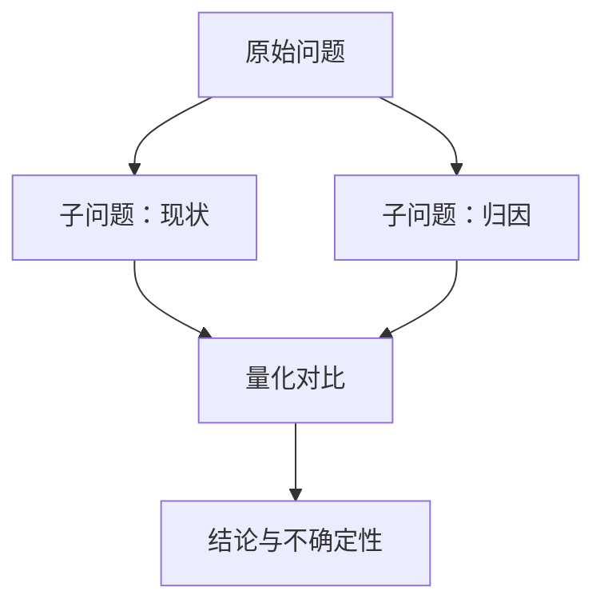

<!--
  research-report · Markdown report skeleton (text output mode)
  =============================================================
  Use when the user asked for Markdown, or the target is a repo README / PR
  description / email where inline HTML and JS are wrong.
  Same canonical anatomy as the HTML mode: BLUF → 研究逻辑 → 关键发现 →
  局限与不确定性 → 附录. Keep the order even when a section is short.
  Charts: Markdown has no JS runtime here, so quantitative figures are either
  tables (preferred for exact numbers) or ```mermaid blocks (rendered by GitHub,
  GitLab, and most editors). If a chart must be a real image, link a PNG file
  next to the report — never a CDN URL.
  Delete this comment block before delivering. Switch section names + lang to
  English for an English report.
-->

# [报告标题：写成一句结论，而不是一个主题]

**日期** [YYYY-MM-DD] · **类型** [quick | full] · **语言** [zh-CN | en] ·
**生成** [模型名] via [Agent/Harness]，[已人工复核 | 未人工复核]

<!-- 元信息一行即可；模型披露是必需项，不是可选项。 -->

## 核心结论（BLUF）

> [一句话答案。读者只读这一句也能正确行动。]
>
> - [支撑点 1 — 带数字或来源]
> - [支撑点 2]
> - [支撑点 3 — 可省]

**下一步**：[需要读者做什么；没有就删掉这行]

## 研究逻辑

<!-- 做了什么、为什么这么做：问题拆解、来源与时间窗、判据、明确排除项。 -->

- **问题拆解**：[子问题 → 对应下面哪一节]
- **来源与时间窗**：[数据/文献从哪来、覆盖到哪一天]
- **方法与判据**：[怎么算、怎么选、阈值]
- **排除项**：[没查什么，为什么可以不管]



<!-- 上图：研究路径。DELETE IF UNUSED — 关系简单时一句话就够了。 -->

## 关键发现

<!-- 每个 h3 一条发现：论断 → 证据（表或图）→ 含义。按决策价值排序，不按发现顺序。 -->

### [发现 1：一句可被判真的陈述]

[论断，然后给证据。]

| 维度 | 实验组 | 对照组 | 差值 |
| --- | ---: | ---: | ---: |
| [指标 1] | [0.00] | [0.00] | [+0.00] |
| [指标 2] | [0.00] | [0.00] | [+0.00] |

<!-- `---:` 把数值列右对齐（所有常见渲染器都支持）；单位与口径写进表题或表头。 -->

### [发现 2]

[论断 + 证据。]

```mermaid
xychart-beta
    title "[趋势标题]"
    x-axis [1月, 2月, 3月, 4月, 5月, 6月]
    y-axis "成本（元/单）" 0 --> 10
    line [9.4, 8.8, 8.1, 7.6, 7.2, 6.9]
```

<!-- xychart-beta 需要 Mermaid ≥ 10.6（GitHub、GitLab、mermaid.live 都支持）。
     渲染器不支持时不要硬撑：换成上面的表格，或用 HTML 输出模式跑真图表。 -->

## 局限与不确定性

<!-- 必需章节，不可删。不确定的地方写清置信度与反转条件。 -->

- **样本与覆盖**：[多大、多新、漏了什么]
- **口径与可比性**：[定义/时间窗差异]
- **置信度**：[高/中/低] — [什么条件下结论会反转]
- **未决问题**：[还需要什么数据]

## 附录

<details>
<summary>A. 方法与口径细节</summary>

[抽取规则、清洗步骤、公式、抽样方式。]

</details>

### B. 来源清单

| # | 来源 | 用途 | 获取日期 |
| --- | --- | --- | --- |
| 1 | [标题](https://example.com/source) | [支撑哪个发现] | [YYYY-MM-DD] |
| 2 | [标题](https://example.com/other) | […] | [YYYY-MM-DD] |

<!-- 来源必须是可点开的链接（这是引用，不是页面加载的资源）。数字口径：四舍五入到 [n] 位。 -->
